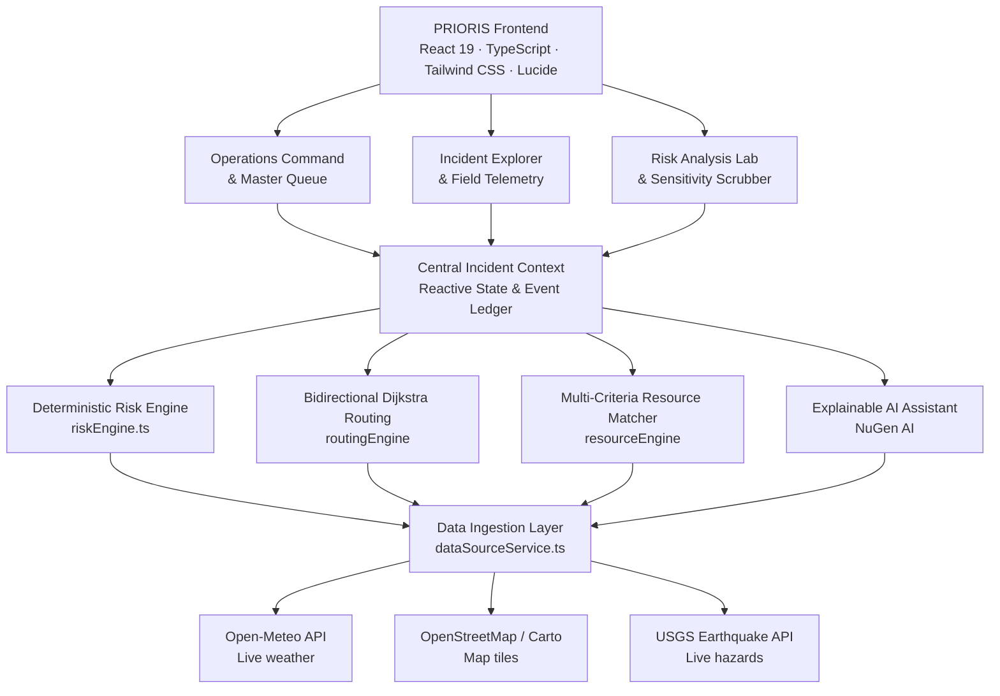

<div align="center">

# 🌊 PRIORIS
### Predictive Response & Operational Intelligence for Resilient Incident Systems
*Smarter priorities. Safer communities.*

An AI-assisted decision-support platform for emergency coordinators managing climate-induced urban flood crises.

[](https://github.com/Rajwardhan-Patil/PRIOSIS)
[](https://react.dev/)
[](https://www.typescriptlang.org/)
[](https://tailwindcss.com/)
[](https://github.com/Rajwardhan-Patil/PRIOSIS)
[](https://nodejs.org/)

[Overview](#-overview) · [Risk Model](#-risk-prioritization-model) · [Architecture](#%EF%B8%8F-architecture) · [AI Layer](#-nugen-ai-tactical-layer) · [Data Sources](#-data-sources-live-vs-simulated) · [Demo](#-evaluator-walkthrough) · [Setup](#-getting-started) · [Governance](#%EF%B8%8F-governance--responsible-use)

</div>

---

## 📌 Overview

During an urban flood, coordinators must decide which wards to help first, which assets to send, and which roads are still safe, often within minutes and with incomplete information.

**PRIORIS** fuses five factors (hazard severity, population exposure, social vulnerability, accessibility, and resource scarcity) into a transparent, deterministic risk score. On top of that score it provides:

- 🎯 **Ward prioritization:** A live, ranked queue that re-sorts dynamically as conditions change.
- 🚤 **Resource matching:** Suitability-ranked recommendations for boats, NDRF/SDRF teams, ambulances, and shelters.
- 🛣️ **Route replanning:** Dijkstra-based detours around flooded or impassable roads.
- 🧠 **Explainable AI briefings:** Short natural-language directives generated by a lightweight LLM, with a rule-based fallback.
- 🧾 **Audit trail:** A tamper-evident ledger of every action with exact timestamps.

> **Scenario:** The reference scenario is a fictional monsoon flood in Pune (Mutha/Mula river basin, Khadakwasla dam discharge).  
> **Integrity:** Scoring is never delegated to the LLM. The AI layer only explains results. The mathematics stays deterministic and auditable.

---

## ✨ Key Features

| Module | What it does |
| :--- | :--- |
| **Operations Command** | Master priority queue, worst-ward highlights, and one-click AI operational directive. |
| **Incident Explorer** | Browse, create, and inject incidents (e.g., a cloudburst) with field telemetry. |
| **Risk Analysis Lab** | 5-factor radar chart, weighted-contribution bars, and a sensitivity scrubber. |
| **Resource Allocation** | AI suitability matching with one-click Dispatch Asset that updates resource scarcity instantly. |
| **Route Replanning** | Toggle roads as impassable and watch a safe bypass (with distance/time delta) appear on the map. |
| **Audit Ledger** | Timestamped, tamper-evident log of all operator actions. |
| **Dual Visual Modes** | Dark mode for 24/7 operations centers, high-contrast white for daylight field tablets. Toggle with the top bar or <kbd>T</kbd>. Map tiles adapt automatically and the preference is persisted. |

---

## 🧮 Risk Prioritization Model

The engine uses a normalized, deterministic 5-factor multi-criteria model. All inputs and the final score are on a 0–100 scale:

$$\text{Risk Score} = 0.35 \cdot \text{Hazard} + 0.25 \cdot \text{Exposure} + 0.20 \cdot \text{Vulnerability} + 0.10 \cdot \text{Accessibility Risk} + 0.10 \cdot \text{Resource Scarcity}$$

### Factors

| Factor | Weight | Inputs |
| :--- | :---: | :--- |
| **Hazard Severity** | 35% | Water depth, flood gauge telemetry, rainfall rate (mm/hr), dam discharge volume. |
| **Population Exposure** | 25% | Ward census count, population density, proximity to Mutha/Mula riverbanks. |
| **Social Vulnerability** | 20% | Elderly and pediatric ratio, slum/kaccha housing density, drainage deficits. |
| **Accessibility Risk** | 10% | Arterial road submergence, bridge status (e.g., Baba Bhide causeway), evacuation isolation. |
| **Resource Scarcity** | 10% | Deficit of unassigned boats, SDRF/NDRF units, ambulances, and shelter beds. |

### Classification Tiers

| Tier | Score Range | Recommended Posture |
| :--- | :---: | :--- |
| 🔴 **Critical** | $\ge 75.0$ | Immediate life-safety threat. Targeted siren evacuation and swift-water boats. |
| 🟠 **High** | $55.0 - 74.99$ | Pre-position ALS ambulances and mobile dewatering pumps. |
| 🟡 **Moderate** | $35.0 - 54.99$ | Active telemetry monitoring and community shelter standby. |
| 🟢 **Low** | $< 35.0$ | Passive sensor surveillance. |

### Worked Example (illustrative values)

| Factor | Score | Weight | Contribution |
| :--- | :---: | :---: | :---: |
| **Hazard** | 90 | 0.35 | 31.50 |
| **Exposure** | 85 | 0.25 | 21.25 |
| **Vulnerability** | 80 | 0.20 | 16.00 |
| **Accessibility Risk** | 70 | 0.10 | 7.00 |
| **Resource Scarcity** | 60 | 0.10 | 6.00 |
| **Total** | | | **81.75 → Critical** |

> ⚠️ **Prototype calibration:** Weights and thresholds are exploratory and must be calibrated with civil-defense authorities before any real-world use.

---

## 🏗️ Architecture



### Design Principles
1. **Deterministic core:** Risk, routing, and matching are pure, testable functions.
2. **Reactive single source of truth:** A central incident context drives every view.
3. **Graceful degradation:** Every AI-dependent feature has a rule-based fallback.
4. **Transparency first:** Live vs. simulated data is explicitly labeled.

---

## 🤖 NuGen AI Tactical Layer

PRIORIS includes a small LLM layer powered by **NuGen AI** to turn numbers into plain-language guidance, without touching the scoring math.

| Parameter | Configuration |
| :--- | :--- |
| **Endpoint** | `https://api.nugen.in/api/v3/inference/chat/completions` |
| **Model** | `Qwen/Qwen2.5-0.5B-Instruct` |

### Capabilities
- **Operational directive synthesis:** In the *Command* console, clicking `NuGen AI` produces a concise two-sentence briefing combining the worst ward's risk factors, active Khadakwasla spillway discharge, and impassable-causeway detours.
- **Tactical Advisor modal:** Open from the top-bar `NuGen` chip or press <kbd>N</kbd> for SitReps, evacuation protocols for vulnerable populations, and corridor-clearance guidance.
- **Deterministic fallback:** If connectivity drops or inference times out, the system switches to rule-based directives with no disruption to the workflow.

---

## 📡 Data Sources: Live vs. Simulated

| Data Component | Provenance | Provider | Status |
| :--- | :--- | :--- | :---: |
| **Pune weather telemetry** | External API | Open-Meteo, ECMWF/GFS models (18.52°N, 73.85°E) | 🟢 **LIVE** |
| **Cartographic basemap** | Map tiles | OpenStreetMap / CartoDB Voyager | 🟢 **LIVE** |
| **Global seismic monitoring** | External API | USGS Earthquake Hazards Feed (GeoJSON) | 🟢 **LIVE** |
| **Urban flood incidents** | Scenario | Fictional Pune monsoon flood scenarios | 🟣 **SIMULATED** |
| **Khadakwasla dam spillway** | Scenario | Mutha basin discharge gauge telemetry | 🟣 **SIMULATED** |
| **Emergency units & shelters** | Scenario | Synthetic NDRF, SDRF, ALS ambulance staging | 🟣 **SIMULATED** |

*Note: No real incident, unit, or dam data is used. Only weather, map tiles, and seismic feeds are live.*

---

## 🧭 Evaluator Walkthrough

Use the docked **Evaluation Tour** bar to follow these eight steps:

| # | Step | What to observe |
| :-: | :--- | :--- |
| **1** | **Inspect the initial priority queue in Operations Command** | Kasba Peth (Old City) ranks #1 Critical (82.2/100) due to river proximity and high exposure. |
| **2** | **Inspect the factor breakdown in Risk Analysis** | 5-factor radar chart and weighted-points contribution bars. |
| **3** | **Inject a cloudburst incident** | A simulated 115 mm/hr cloudburst hits Paud Road, Kothrud (Ward 18). |
| **4** | **Observe dynamic re-ranking** | Kothrud's hazard score jumps from ~44 to 88+, moving it into the Critical tier. |
| **5** | **Match and dispatch a rescue unit in Resource Allocation** | Click *Dispatch Asset* to send NDRF Boat Team 1 to Kothrud; its scarcity index drops instantly. |
| **6** | **Simulate an arterial blockage in Route Replanning** | Mark Karve Road (Kothrud → Deccan) *Impassable* (85 cm waterlogging). |
| **7** | **Verify Dijkstra rerouting** | The flooded corridor shows as a red dashed line, with an emerald-green bypass (+1.8 km, +4 min). |
| **8** | **Review the audit trail** | The ledger shows every event with exact timestamps. |

---

## 🚀 Getting Started

### Prerequisites
- **Node.js:** v18+ (tested on v24.16.0)
- **npm:** v9+

### Install and Run
```bash
# Clone the repository
git clone https://github.com/Rajwardhan-Patil/PRIOSIS.git
cd PRIOSIS

# Install dependencies
npm install

# Run the 16-test deterministic verification suite
npm test

# Start the development server
npm run dev
```

### Production Build
```bash
# Build the production bundle
npm run build

# Preview the bundle locally
npm run preview
```

### Keyboard Shortcuts
| Key | Action |
| :---: | :--- |
| <kbd>T</kbd> | Toggle dark / white mode |
| <kbd>N</kbd> | Open the NuGen Tactical Advisor |
| <kbd>L</kbd> | Toggle Marathi (मराठी) / English labels |
| <kbd>?</kbd> | Open Keyboard Shortcuts cheat sheet |
| <kbd>1 – 6</kbd> | Switch primary navigation tabs |

---

## 🛡️ Governance & Responsible Use

- **Human in the loop:** PRIORIS supports decisions. It never autonomously commands units or issues evacuation orders.
- **Official hierarchy:** It does not replace India's **112** emergency helpline, **NDMA SACHET** alerts, or **IMD** weather bulletins.
- **Experimental heuristics:** Weights, thresholds, and scenarios are prototype-grade and must be validated with civil-defense experts before operational use.
- **Transparent AI:** The LLM never alters risk scores, and its output is clearly separated from deterministic results.

---

## 🏆 Context

Built as a prototype for the **PRIORIS Round 2 Hackathon**, theme *AI for Climate Change*.

<div align="center">

**PRIORIS** · *Smarter priorities. Safer communities.*

</div>
